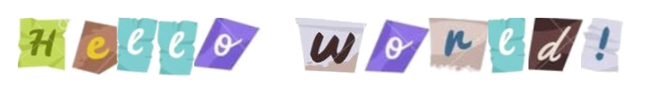

# randy

A CLI tool that converts text into images using hand-cut character images (ransom-note style) or Comic Sans font rendering. Each character is randomly tilted and slightly overlapped for a natural collage effect. The result is automatically copied to your clipboard.

## Examples

### Ransom mode (default)

```bash
randy -text "Hello World!"
```



### Comic Sans mode

```bash
randy -text "Hello World!" -mode comic-sans
```


## Installation

```bash
go build -o randy .
```

## Usage

```bash
randy -text "Your message here"
```

Text can also be passed as positional arguments:

```bash
randy Hello World
```

## Flags

| Flag | Default | Description |
|------|---------|-------------|
| `-text` | | Text to render (required, or use positional args) |
| `-output` | `output.png` | Output file path |
| `-mode` | `ransom` | Rendering mode: `ransom` (cut-out images) or `comic-sans` (font) |
| `-words-per-line` | `5` | Maximum words per line before wrapping |
| `-char-height` | `64` | Height of each character in pixels |
| `-char-gap` | `-8` | Gap between characters in pixels (negative = overlap) |
| `-word-gap` | `30` | Gap between words in pixels |
| `-line-gap` | `20` | Gap between lines in pixels |
| `-max-tilt` | `5.0` | Maximum random tilt per character in degrees |
| `-bg` | `FFFFFF` | Background color as hex. Use `none` for transparent |
| `-padding` | `20` | Padding around the image in pixels |
| `-align` | `center` | Text alignment: `left`, `center`, or `right` |
| `-no-clipboard` | `false` | Disable automatic clipboard copy |
| `-font` | (auto) | Path to TTF font file (comic-sans mode only) |
| `-font-color` | `000000` | Font color as hex (comic-sans mode only) |

## Supported Characters

In ransom mode, the following characters are supported via handwritten image assets:

- **Letters**: A-Z, a-z
- **Digits**: 0-9
- **Symbols**: `!` `?` `.` `,` `@` `$` `%` `#` `"`

In comic-sans mode, any character supported by the font can be rendered.

## Clipboard Support

By default the generated image is copied to the system clipboard. This works on:

- **macOS** via `osascript`
- **Linux** via `xclip`
- **Windows** via PowerShell

Use `-no-clipboard` to disable this behaviour.
